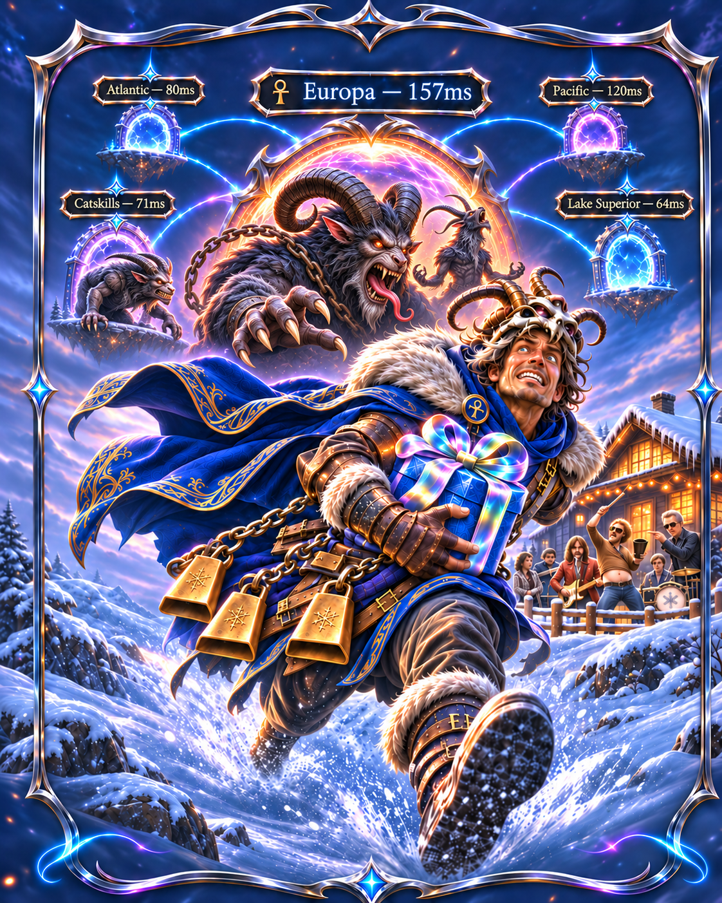

# Krampuslauf

<p align="center">
  
</p>

Krampuslauf is a Windows app for seasonal gift runs in the official Ultima Online Classic Client with Razor Enhanced. **Character Seeder** creates characters in open slots across your selected shards. **Gift Cycler** logs existing characters in and out so eligible characters can receive their holiday gifts. Built by Mystic Llama.

**Public source beta · 1.8.0-beta.4**

[Configuration guide](CONFIGURATION.md) · [Changelog](CHANGELOG.md) · [Report an issue](https://github.com/mystic-llama/krampuslauf/issues)

## Seed now for the December 2026 gifts

Use **Automation > Character Seeder** to create characters in the open slots you want to use this season. For the **2026 Holiday Gift Token**, Broadsword lists a minimum age of **30 days** for veteran characters and a **December 1–31, 2026** redemption window (Eastern time). [Official Ultima Online Publish 125 notes](https://uo.com/wiki/ultima-online-wiki/publish-notes/publish-125/)

A character created on November 19 reaches 30 days old on December 19. If you seed now, let the new characters reach 30 days old, then select **New gift cycle** and start **Gift Cycler** before the window closes.

## Where the name comes from

*Krampuslauf* is German for “Krampus run,” an Alpine winter tradition in which people wearing horned masks and bells parade around Saint Nicholas Day. The name gives the app’s own run across Ultima Online shards a holiday theme. [Austrian National Tourist Office](https://www.austria.info/en-us/inspiration/raucous-traditions/)

Ultima Online’s Krampus boss is a separate seasonal encounter. Krampuslauf handles character creation and holiday gift logins. [The Krampus Encounter](https://uo.com/wiki/ultima-online-wiki/seasonal-events/the-krampus-encounter/)

## What is new

- **Built-in menu positions.** Menu markers and click positions are built in and measured from the Classic Client's fixed 640 × 480 game area, with automatic display-scaling detection. The calibration pages and all Town Crier options were removed; **Setup > Game Client > Check current screen** verifies recognition, and **Setup > Game Client > Click points** re-records any point that misses. See CHANGELOG.md.
- **Character appearance.** Choose sex, race, hair, facial hair or horn styles, skin tones and race-specific hair/horn colours for new characters, Fixed or Random. The name-typing test was retired.
- **Keep one slot empty on every shard** under **Automation > Character Seeder**. Select the account's actual capacity (5, 6 or 7), enable the option for the selected account. Both creation modes use a total limit of capacity minus one; no per-shard slot list is needed. The setting is off by default.
- Standalone reservation checks existing character rows before creating more. It may log existing characters in and out, but does not record them as gift-complete. Gift Cycler can still process an existing seventh character. Already-full shards are left intact; no character is deleted.
- Screen-marker failures before a click no longer claim that a mouse pause occurred. The prompt explains how a tooltip can obscure a marker and where to recapture it. Mouse timing is unchanged.

### Included from beta.3

- Profile recovery validates saved paths, rejects linked or redirected locations, checks backup format and bounds file sizes before restoring.
- The 250 × 250 Krampuslauf logo sits beside the Setup checklist; the compact banner icon stays in place.
- MIT license, private-data exclusions and release configuration instructions are included.

### Also included from beta.2

- Activity activates before the worker starts, preventing the startup focus race. Shard selection waits briefly and verifies the screen before clicking. A first selection is no longer labeled as a retry attempt.
- A pointer that misses its target pauses for explicit Resume before any click. The same window/screen is checked before a retry. A partially sent double-click is not replayed.
- Escape during a job requests Pause; a second press while paused requests Stop. Click Resume to continue. The shortcut is released when the job ends.

- A 720 × 890 base window, with three full-width main tabs and focused subtabs. Settings pages fit without page scrollbars; long data lists can scroll.
- Krampuslauf artwork in the banner; Help artwork, the GitHub link, donations and theme controls under **Help / Status > Help**. No subtitle under the main title.
- Prominent headings, consistent rounded buttons, smaller colored notices and lime **NEXT** directions with tab names.
- Short error prompts with a concrete next action. Technical details stay in the Activity window and saved activity log; when idle, the app opens the relevant page.
- Saved activity and error logs are available through **Help / Status > Status > Open local data folder**. The duplicate History tab has been removed.
- Combined-mode handoff progress now belongs to a gift cycle. An earlier completed shard cannot silently skip a later cycle. Permanent character and name histories are retained.

## Run the source

Use Windows, Python 3.12 or newer, .NET Framework, the official Classic Client (`client.exe`) and Razor Enhanced. The bridge runs inside Razor; this desktop app uses normal CPython.

1. Clone the repository or extract the [source ZIP](https://github.com/mystic-llama/krampuslauf/archive/refs/heads/main.zip) into a new folder.
2. From that folder, install dependencies: `python -m pip install -r requirements.txt`.
3. Run `Run_WinForms_GUI.bat`, or `python Krampuslauf.py`.

The batch file uses the `py -3` launcher when it is available, then `python` on PATH.

## First-time setup

1. **Setup > Checklist:** use Razor's existing **default** profile. Click **Show bridge script**, add that file in Scripting, and enable **AutoStart at Login**. Do not run the file with desktop Python. Enable **Automatically Open Doors** and **Remember passwords**. Launch the game through Razor. Krampuslauf shows whether it is running as administrator; use **Restart as administrator** so it matches Razor. If Razor has been set to start without administrator rights, leave Krampuslauf unelevated too. **In Game Options (Paperdoll), set Tooltip delay to 5000 ms.** Check all five boxes, then **Save checklist**. The page lists the remaining setup steps in order.
2. **Setup > Profiles:** close Razor and Classic Client. Choose the folder containing `Profiles` and `Backup`, validate it and prepare Krampuslauf. This temporarily unlinks characters in the two `RazorEnhanced.NewProfiles` files while preserving profile names and original backups. Restart Razor, then launch the game through it.
3. **Game client:** select the game window. With the client on any game menu, click **Check current screen** to confirm the menu is recognized. No calibration is needed: menu markers and click positions are built in for the Classic Client's 640 × 480 menus, and Windows display scaling is detected automatically.
4. **Shards:** check row spacing and scan from the top of the shard list. Verify the order; rescan after a Windows time-zone change.
5. **Help / Status > Diagnostics:** log into one character to test the RE bridge. Return to a game menu before a normal run.
6. **Automation > Gift Cycler:** choose shards, optional slot skips and timing, then save run options. Use **New gift cycle** when changing accounts or starting a new gift event. Test one shard first. **Select account** opens the account list. Character creation, appearance, and click-point overrides can wait until that first shard succeeds.

For creation, in **Automation > Character Seeder**, select **Main Account** or **Account 2–15** (five rows of three) then choose naming options under **Automation > Appearance**. That selected account is also used for combined Gift Cycler + Seeder runs. Optionally choose sex, race, styles and skin tones together with profession under **Automation > Appearance**, in Fixed or Random mode. Skin-palette cell centres are built in for all three races; no first-run skin calibration is required. Use **Setup > Game Client > Click points** only to override a missed click.

The optional Account Nickname is capped at 16 characters and changes the displayed radio-button name, never the internal history identity or generated names. Convention names look like `Llama CAT b`; fantasy names are saved before typing and reused after a halt. See [the naming reference](docs/FANTASY_NAMES.md).

## Running Razor without an administrator prompt

Krampuslauf needs the same permissions as Razor Enhanced. When Razor is set to require administrator rights, use **Restart as administrator** on the checklist.

The CUO Handshake Fix Patcher can remove that requirement from Razor. Close Razor Enhanced and the game, open the patcher, select the Razor Enhanced folder, check **Remove admin requirement (Winlator / asInvoker)**, and click **Apply Patch**. The patcher changes the manifest inside `RazorEnhanced.exe` from `requireAdministrator` to `asInvoker` and shows **No admin** when that change is present. Razor then starts with the permissions of whatever launched it, so Krampuslauf does not need to run as administrator either. **Restore Backup** puts the original executable back, including its previous elevation setting. The same patcher can also install its ClassicUO handshake fix; that fix is separate from this administrator option.

## During and after a run

The Activity window provides **Pause**, **Stop** and **Full window**. **Escape pauses; a second press while paused stops.** Resume is an explicit button action. The mouse remains usable for the controls; it is not locked. If another application owns Escape, the Activity window reports that the shortcut is unavailable and the buttons still work.

A mouse-targeting failure pauses before clicking and keeps the current operation. Leave the game window and screen unchanged, then click Resume. If they changed, the app refuses to repeat the click. Local navigation deadlines exclude paused time. A Razor command already in progress may finish before the worker reaches its pause point; Stop invalidates the bridge session. Existing hard stops for uncertain creation, identity failures and PyAutoGUI's corner fail-safe remain.

Full window does not stop automation. After a halt, read the instructions and explicitly return to the main window. A stopped character can remain logged in; check the game before resuming.

After a route failure, return the game to the login or shard menu and restart the Seeder. Previously confirmed characters are retained, their interrupted routes are not replayed, and finished-shard checkpoints remain. No reset button is needed. If a creation was submitted but never confirmed, inspect the character list and saved activity log before retrying.

When finished, close Razor and Classic Client and use **Setup > Profiles > Restore original profiles**.

## Updating and saved data

Close Krampuslauf before updating. Keep a copy of the working application and back up `%LOCALAPPDATA%\Krampuslauf`. **Every version uses this same data folder**, even from a separate source or EXE folder. Do not erase it to fix a failed run. The first launch moves an older data folder into this one when the new folder is not already there.

Extract this full source package into a new folder. An existing EXE is not updated by replacing source files; rebuild it with the included build script.

`krampuslauf_bridge.py` is unchanged from the supplied 1.7.6 baseline. Existing users running that exact bridge need no bridge update for this beta. New users must install the included script in Razor.

When first using older creation history, the app backs up the original ledger and conservatively tags previously untagged names to the current cycle. Those names remain excluded for that cycle; a later new cycle can visit them. Pending characters stay protected in every cycle. Old handoffs without a cycle ID are not used to skip a shard. **New cycle / account** does not reset creation or fantasy-name ledgers.

Krampuslauf does not ask for your game password. Credentials remain in Razor. Saved window titles are cleared from settings; The activity log can contain character and shard names. Review entries before sharing them.

## Artwork

- `assets/readmelogo.png` is the artwork at the top of this README.
- `assets/logo.png`: checklist artwork, displayed at up to 350 x 438 logical pixels with its original proportions.
- `assets/title_banner.png`: title artwork fills the taller header; transparent outside margins are ignored.
- `assets/helplogo.png`: supplied 350 × 350 PNG on the right of Help, with support on the left and theme controls below.
- `assets/Krampuslauf.ico`: window and build icon.

These are ordinary files, without base64. Replace PNGs and restart to change them. Rebuild to change the EXE's embedded icon. Save theme changes under **Help / Status > Help**, then restart.

## Build and verify

Run `Build_Windows_EXE.bat` with Python 3.12 or newer. It installs dependencies and PyInstaller, then creates `dist\Krampuslauf\Krampuslauf.exe`. Distribute the **entire** `dist\Krampuslauf` folder, including `_internal`, artwork, bridge, LICENSE, CONFIGURATION.md and the docs folder.

```text
python -m pip install -r requirements-dev.txt
python -m pytest tests -q
python tools/build_layout_preview.py
python tools/check_windows_ui.py --theme dark --output ui-check-dark
python tools/check_windows_ui.py --theme light --output ui-check-light
```

The native UI check uses temporary data and sends no game input. Run it at 100%, 125% and 150% display scaling. Above 100%, Windows scales the whole form for readability. The offline HTML preview shares the real layout definitions but cannot verify native rendering or automation.

See the [GitHub publishing guide](docs/GITHUB_PUBLISHING.md) and [source security review](docs/SECURITY_REVIEW.md) for maintainer notes.

## Beta limits and feedback

Gift completion means verified world entry, the configured wait and confirmed logout; inventory is not inspected to prove a gift arrived. Newly created characters are excluded from their creation cycle. Verify safe logout on the real Moonglow route. The built-in menu layout was measured at 100% Windows display scaling; verify **Check current screen** at other scaling levels before an unattended run.

Slot reservation depends on the capacity you select and character-row detection; capacity is not automatically discovered. With reservation enabled, 7/6/5-slot accounts have creation ceilings of 6/5/4 total characters. Unsupported shards are excluded from both creation and gift runs. It cannot free space on an already-full shard. Validate one partly populated shard in the real client before an unattended run.

For a report, include the beta version, display scaling, tab/action, expected versus actual behavior and the relevant saved activity-log entry. Review personal details before sharing through the GitHub project linked on Help.

## License

MIT — Copyright (c) 2026 Mystic Llama. See [LICENSE](LICENSE). Dependencies retain their own licenses; keep their bundled notices when distributing the Windows build.

## Upgrading an existing install

Start source releases with `Run_WinForms_GUI.bat` (which opens `Krampuslauf.py`). New builds are written to `dist/Krampuslauf/Krampuslauf.exe`.

In Razor Enhanced, disable every older bridge script and its AutoStart entry. Add `krampuslauf_bridge.py` from this release and enable AutoStart at Login. Run only one bridge script at a time.

Open Krampuslauf once before starting Razor. If `%LOCALAPPDATA%\Krampuslauf` is not already present, the first launch moves the previous `%LOCALAPPDATA%\UOGiftMonkey` folder there. Saved settings, profile backups, history, and name reservations stay in the new folder. Existing compiled releases are not updated by replacing source files; rebuild to get the new name and artwork.

## Account selection and restart progress

Choose an account under Automation > Character Seeder. An optional nickname replaces its radio-button caption. Selecting an account automatically loads its saved settings, exclusions, slot skips and history; the last selection returns at launch. Start confirmations identify the account receiving progress. Accounts retain distinct history keys even after a nickname change.

Standalone Seeder saves a finished-shard checkpoint when New is absent or its creation limit is reached. Restarting skips those shards without opening them and resumes the first unfinished shard. Already-created characters are never submitted again, and interrupted routes are not automatically replayed on a new logged-out run.

Gift Cycler provides a checked shard list with All shards / No shards controls. Selections save per account. Distant in-game shard rows use a burst of scroll-arrow clicks with one cursor placement, followed by screen verification before selecting a shard. A partial/interrupted burst halts instead of guessing the row.

### Existing installations

Saved nicknames, settings, and progress stay in `%LOCALAPPDATA%\Krampuslauf`. Enable only `krampuslauf_bridge.py`.

**Inn-route pause:** Automation > Character Seeder > Before inn route (sec) controls the wait after verified world entry, before requesting the Moonglow inn route. Range 0–120 seconds, default 5; saved per account.


The profile-isolation close reminder offers **Return to Profiles** and **Close anyway**. Its X, Escape and Enter return to Profiles and keep Krampuslauf open. Close Razor and the game before clicking **Restore original profiles**.

Optional donations are on **Help / Status > Help**. The page explains why they help — keeping new applications and scripts coming, and covering the in-game materials, skills and gear used to write, test and publish them. **Donate with PayPal** opens https://www.paypal.com/donate/?hosted_button_id=T6R4TNGR4UUL6. In-game gold can be sent by reaching Mystic on Discord at **@mystikllama**.
